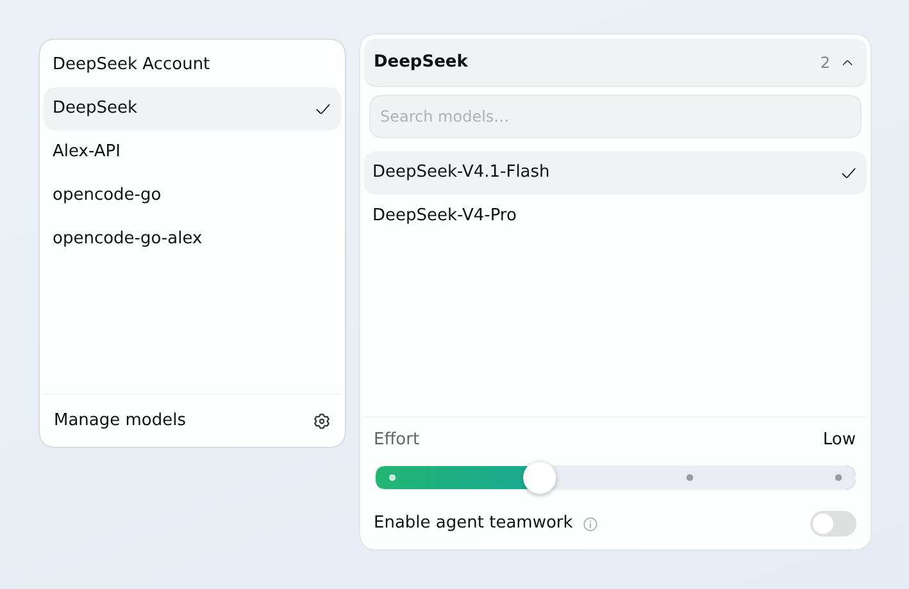

# dsh-model-deck

A card-style model picker for the DeepSeek Harness composer.



The top bar is the provider; hovering it (or `←` / `Enter` / tap) expands a provider column to the **left** so the card itself never moves. The middle is a **fixed-height, scrollable** model list with a search box and per-row capability badges. The bottom is an inline **thinking-effort slider** whose detents are the levels the selected model actually declares.

## Features

- **Provider column on the left** — the composer trigger sits at the bottom-right, so the column opens leftwards and cannot be clipped by the viewport edge.
- **Stable card** — fixed card height (404 px) and fixed provider-column height (320 px) at 100 % zoom; lists scroll inside them. Switching models never resizes the picker.
- **Capability badges** — every row shows `Text` / `Vision` from the Host's own LLM registry (`inputModalities`), not a guess.
- **Inline effort slider** — gradient fill, grey unfilled side, one detent per declared level, live preview while dragging. Levels always belong to the **current model route**; the Host validates them.
- **Honest non-adjustable states** — a route that declares no reasoning levels shows `Provider default` with a note instead of a slider that would fail; when the same model is adjustable under another provider, the note names it.
- **No auto-close on pick** — choosing a model or an effort updates the card in place; only an outside press or `Esc` closes it.
- **Keyboard** — `↑/↓` within a column, `←` opens the provider column, `→` / `Esc` leaves it, `Esc` again closes; `Tab` settles, `Shift+Tab` backs out.

## Install

From the marketplace: install **dsh-model-deck** and restart DSH.

Or from this repository:

```sh
dsh plugin --profile web add github:Sakura7301/dsh-model-deck
```

The bundle patch disables the stock `@deepseek-ai/dsh-client-ui-model-selection` row and inserts this package in its place, so one slot has exactly one owner. Disabling or removing the bundle restores the stock selector.

## How the capability badges are sourced

The browser-side catalog (`session/modelCatalog`) intentionally omits `inputModalities`, so the Host half of this plugin exposes one read-only route:

```
GET /model-deck/capabilities
→ { "provider-id": { "model-id": ["text", "image"] }, … }
```

It reads the live `ctx.llm` registry and passes the same browser-trust fence as the shipped custom routes. The browser fetches it once per page; when the route is unavailable (for example a Desktop build without the HTTP carrier) the badges are simply omitted.

## Build

`lib/client.js` is a prebuilt browser bundle (wrapped in `window.__ModuleLoader__.load`).

```sh
cd build && npm install     # esbuild + clsx, build-time only
cd .. && npm run build      # node build/build.mjs
```

Source layout:

| Path | Purpose |
| --- | --- |
| `src/client/ModelSelect.tsx` | the card, provider column, model list, effort slider, keyboard handling |
| `src/client/styles.css` / `styles.ts` | static class names + one-time stylesheet injection |
| `src/client/index.ts` | client entry: `/model` command contribution and the composer seat |
| `src/client/catalog.ts` / `directory.ts` / `service.ts` | shared catalog + per-session selection state |
| `src/client/locales.ts` | `model` namespace dictionaries (8 locales) |
| `src/client/manage.ts` | "Manage models" bridge into Settings → Models |
| `lib/index.js` | Host half (capability route) |

## Limitations

- The browser half tracks the `@deepseek-ai/dsh-client-ui-model-selection` protocol of DSH 0.2.2-rc.x; a future Slot or catalog change needs `src/client/` realigned.
- DSH does not expose a public "open settings" verb to ordinary plugins, so **Manage models** walks the account-menu → Settings → Models DOM path with guarded lookups. It is the only place to replace if that surface changes.
- Reasoning levels are per provider route. A route whose manifest declares none is read-only here; DSH itself rejects effort values the route does not declare.

## License

MIT
