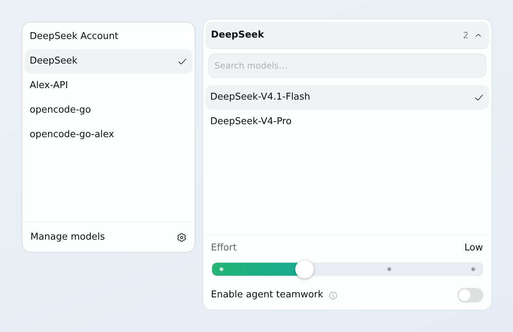

# dsh-model-deck（模型卡组）

把 DeepSeek Harness 输入框的模型选择器换成一张卡片式选择器。



顶栏是当前供应商；鼠标移上去（或按 `←` / `Enter` / 触屏点一下），供应商列在卡片**左侧**展开，卡片本身不动。中间是**固定高度、可滚动**的模型列表，带搜索框，每行右侧显示模型能力徽标。底部是内嵌的**思考强度滑块**，挡位就是当前模型真正声明的推理等级。

## 特性

- **供应商列向左展开**——模型按钮本来就在右下角，向左展开不会被视口边缘裁掉。
- **卡片尺寸稳定**——100% 缩放下卡片固定 404px、供应商列固定 320px，列表各自滚动；切换模型不会让选择器忽大忽小。
- **能力徽标**——每行的 `文本` / `视觉` 来自 Host 的 LLM 注册表（`inputModalities`），不是猜的。
- **内嵌强度滑块**——渐变填充、右侧灰底、每个挡位一个圆点，拖动实时预览。
- **不可调时如实显示**——路由没声明档位时显示「供应商默认」+ 说明（同一模型在别的供应商下可调时，说明里会点名），而不是给一个点了会失败的滑块。
- **选中不关卡片**——换模型或改强度都是就地更新，只有点外部或 `Esc` 才关闭。
- **键盘**——`↑/↓` 列内移动，`←` 打开供应商列，`→` / `Esc` 退回，`Esc` 再关；`Tab` 采纳，`Shift+Tab` 返回。

## 安装

在插件市场安装 **dsh-model-deck** 后重启 DSH；或从仓库安装：

```sh
dsh plugin --profile web add github:Sakura7301/dsh-model-deck
```

组合包的 patch 会停用官方的 `@deepseek-ai/dsh-client-ui-model-selection` 行并插入本包，一个 slot 只被一个条目认领；停用或卸载本插件即恢复官方选择器。

## 能力徽标的数据来源

浏览器拿到的 `session/modelCatalog` 不含 `inputModalities`，所以本插件的 Host 半侧提供一条只读路由：

```
GET /model-deck/capabilities
→ { "供应商": { "模型": ["text", "image"] }, … }
```

它现场读取 `ctx.llm` 注册表，走与官方自定义路由相同的浏览器信任栅栏。浏览器每页只取一次；路由不可用（例如没有 HTTP 载体的桌面形态）时就不显示徽标，不影响菜单。

## 构建

`lib/client.js` 是预构建的浏览器 bundle（`window.__ModuleLoader__.load` 包裹）。

```sh
cd build && npm install     # 仅构建期依赖：esbuild + clsx
cd .. && npm run build      # node build/build.mjs
```

源码结构：

| 路径 | 作用 |
| --- | --- |
| `src/client/ModelSelect.tsx` | 卡片、供应商列、模型列表、强度滑块与键盘交互 |
| `src/client/styles.css` / `styles.ts` | 静态类名 + 一次性样式注入 |
| `src/client/index.ts` | 客户端入口：`/model` 命令贡献与 composer 模型位 |
| `src/client/catalog.ts` / `directory.ts` / `service.ts` | 共享目录与会话级选择状态 |
| `src/client/locales.ts` | `model` 命名空间的 8 份词典 |
| `src/client/manage.ts` | 「管理模型」到 设置 → 模型 的桥 |
| `lib/index.js` | Host 半侧（能力路由） |

## 已知边界

- 浏览器半侧跟随 DSH 0.2.2-rc.x 的 `@deepseek-ai/dsh-client-ui-model-selection` 协议；官方后续若改 Slot 或目录协议，需要重新对齐 `src/client/`。
- DSH 没有向普通插件开放「打开设置」的动词，所以「管理模型」走的是账号菜单 → 设置 → 模型的 DOM 路径，并带守卫；这个界面变化时只需替换 `manage.ts`。
- 推理档位按供应商路由声明；路由声明为空时这里只读——DSH 自己也会拒绝该路由不支持的档位。

## License

MIT
